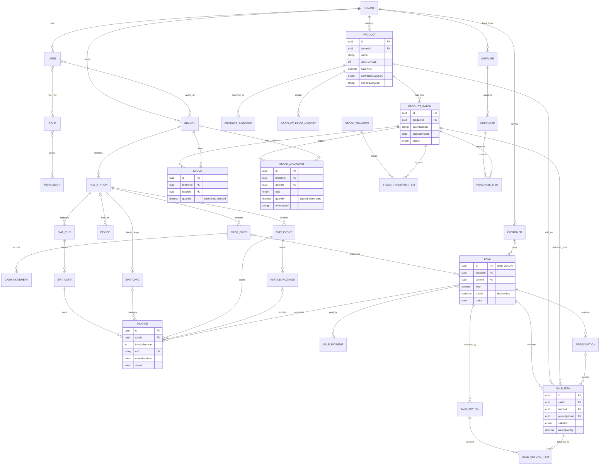

# Pharma ERP — Database Data Model (`dbmodel.md`) — v2

Relational model for **Pharma ERP**: multi-tenant pharmacy POS, batch/expiry inventory (FEFO), controlled-medicine dispensing, offline-first sync, and Bolivian electronic invoicing (SIN SIAT).

> **Status of this revision.** The Prisma schema in section 6 passes Prisma schema validation (37 models, 15 enums). It has **not** been run against a live database, and the SIAT-specific fields come from general knowledge of the SIN technical specification, so verify them against the current SIN documentation before building the fiscal module (see section 9).

---

## 1. Design Principles

1. **Strict multi-tenancy, enforced twice.** Every business table carries an indexed `tenantId` with a foreign key to `Tenant`, and Postgres **Row Level Security** blocks cross-tenant reads and writes even if application code forgets a filter (section 7).
2. **Offline-first with client UUIDv7.** Terminals generate primary keys, so the primary key *is* the idempotency key. Replaying a push is an upsert on `id`, not a duplicate.
3. **FEFO inventory in base units.** Stock is tracked per branch and batch, and always stored in the smallest sellable unit (one tablet, one ampoule). A pack holds `Product.unitsPerPack` base units, which makes loose sales possible.
4. **Ledger first.** `StockMovement` is an append-only, signed ledger. `Stock` is a server-maintained balance derived from it. Clients push movements or the sales that cause them, never balances.
5. **Controlled-substance compliance.** Each controlled `SaleItem` links to a `Prescription`. A sale can carry several prescriptions. Prescriptions are immutable legal records.
6. **Fiscal model that matches SIAT.** CUIS, CUFD and CAFC are stored as credentials with validity. Contingency has explicit events and packages. Invoices keep their own customer snapshot and can be re-issued after annulment.
7. **Delta-sync friendly.** Mutable rows have `updatedAt`. Master data uses `deletedAt` tombstones. Transactional records (sales, invoices, movements) are **never deleted**, only cancelled or reversed.
8. **Two clocks.** Records created offline keep the device time (`soldAt`, `clientCreatedAt`, `issuedAt`) separate from the server receive time (`createdAt`). Sync cursors use server time only.

---

## 2. What Changed from v1

| Area | v1 problem | v2 change |
| :--- | :--- | :--- |
| Offline stock | Mutable balance, `balanceAfter`, ambiguous movement sign | Signed append-only ledger, derived `Stock`, no `balanceAfter`, replay-safe unique key on `(tenantId, type, referenceId)` |
| Stock redundancy | `productId` repeated on `Stock` and `StockMovement` | Removed. Batch implies product |
| Purchasing | `PURCHASE` movement with no purchase entities | `Supplier`, `Purchase`, `PurchaseItem` |
| Returns / transfers | Not modeled, `TRANSFER` had one branch | `SaleReturn(+Item)`, `StockTransfer(+Item)`, explicit `TRANSFER_OUT` / `TRANSFER_IN` |
| Loose sales | Decimal quantity only | `unitsPerPack`, `SaleUnit`, `baseQuantity` on lines |
| SIAT | `currentCufd` string, no ranges, events or packages | `SiatCuis`, `SiatCufd` (with control code), `SiatCafc`, `SiatEvent`, `InvoicePackage`; SIN codes on `Product`; unique invoice numbering |
| Invoice vs sale | Strict 1:1 | 1:N with a partial unique index allowing one *live* invoice per sale |
| Multi-tenancy | `tenantId` without relations; cross-tenant references possible | Relations on every table plus RLS |
| Customers | Nullable `complement` in a unique key (NULLs are distinct) | `complement` defaults to `""`; document type enum added |
| Payments | Single `paymentMethod` | `SalePayment` rows (split payments) |
| Controlled drugs | One prescription per sale | `Prescription` 1:N per sale; `SaleItem.prescriptionId`; `controlledCategory` replaces `isControlled` |
| Batches | No status or cost | `BatchStatus` (quarantine, recalled, expired), `costPrice` |
| Products | One barcode, no price history, no regulatory data | `ProductBarcode`, `ProductPriceHistory`, `sanitaryRegistry`, `atcCode`, `laboratory` |
| Cash | Expected cash only | `CashMovement`, stored `difference`, one open shift per station (partial index) |
| Access | No branch scoping, global unique email | `UserBranch`; email unique per tenant |
| Time | Server `createdAt` only | `soldAt`, `clientCreatedAt`, `issuedAt` (device) vs `createdAt` (server); `Device` table |
| Deletion | `Cascade` on legal records | Removed; legal records restrict deletion |
| Redundancy | `idempotencyKey` duplicated the client UUID | Removed |
| Doc / schema drift | "14 tables", fields in prose missing from schema | Schema is the single source of truth: 37 models |

---

## 3. Entity-Relationship Diagram (relationships)

Attributes are shown only for the core inventory and sales entities. See the schema for every field.



---

## 4. Modules at a Glance

| Module | Models | Key rules |
| :--- | :--- | :--- |
| **Tenancy & access** | `Tenant`, `User`, `Role`, `Permission`, `RolePermission`, `UserRole`, `UserBranch`, `Device` | Email is unique **per tenant** (login needs the tenant slug or subdomain). Permission keys come from `packages/contracts/src/permissions.ts`. `UserBranch` limits where a user can operate. `Device` attributes offline records and tracks last sync. |
| **Locations** | `Branch`, `PosStation` | `Branch.code` and `PosStation.posNumber` map to SIAT sucursal and punto de venta. Treat one POS station as one active device at a time, so invoice ranges never collide. |
| **SIAT** | `SiatCuis`, `SiatCufd`, `SiatCafc`, `SiatEvent`, `InvoicePackage` | The CUFD has a 24-hour validity and its `controlCode` feeds the CUF. A CAFC is the authorized number range used while offline. An event opens a contingency window, and the invoices issued inside it are sent as a package. |
| **Purchasing** | `Supplier`, `Purchase`, `PurchaseItem` | Receiving a purchase creates or finds the `ProductBatch`, writes `PURCHASE` movements, and updates `Stock` in one transaction. |
| **Catalog & inventory** | `Product`, `ProductBarcode`, `ProductPriceHistory`, `ProductBatch`, `Stock`, `StockMovement`, `StockTransfer`, `StockTransferItem` | Quantities are in base units. FEFO picks the earliest-expiring `ACTIVE` batch with positive stock. Recalled, quarantined and expired batches are never sold. |
| **Cash** | `CashShift`, `CashMovement` | One open shift per station (partial unique index). Expected cash is snapshotted at close together with the difference. |
| **Sales** | `Customer`, `Sale`, `SaleItem`, `SalePayment`, `SaleReturn`, `SaleReturnItem` | A FEFO sale spanning two batches creates two `SaleItem` rows. Cancelling a sale reverses stock and annuls the invoice. Partial refunds go through `SaleReturn`. |
| **Controlled medicines** | `Prescription` | Created together with the sale. A controlled product cannot be sold without a `prescriptionId` on its line (enforced in the service layer, section 8). |
| **Fiscal** | `Invoice` | Snapshots the customer and total as sent to SIAT. Numbering is unique per POS station and document sector. |
| **Audit** | `AuditLog` | Append-only, no foreign keys so it survives any deletion. |

---

## 5. Conventions

- **IDs:** `String @default(uuid(7))`. Offline-created rows (sales, items, payments, prescriptions, cash events, invoices) are sent with their client-generated id. Everything else uses the server default.
- **Money:** `Decimal(12,2)`. **Quantities:** `Decimal(14,4)`. Never use floats.
- **Enums over strings** for anything with a closed set of values.
- **Snapshots:** customer data on `Sale` and `Invoice` is copied, never joined, so later edits to `Customer` cannot change history.

---

## 6. Prisma 7 Schema (`apps/api/prisma/schema.prisma`)

Validated with Prisma's schema validator. It is meant to replace or extend the existing seed schema. Because the old schema has `User.email` globally unique, migrating to `@@unique([tenantId, email])` needs a migration and a login-flow change.

```prisma
datasource db {
  provider = "postgresql"
}

generator client {
  provider     = "prisma-client"
  output       = "../src/generated/prisma"
  moduleFormat = "cjs"
}

// =============================================================================
// ENUMS
// =============================================================================

/// SIAT tipoDocumentoIdentidad: CI=1, CEX=2, PASSPORT=3, OTHER=4, NIT=5
enum IdDocType {
  CI
  CEX
  PASSPORT
  OTHER
  NIT
}

enum SaleUnit {
  PACK // full box / bottle
  UNIT // loose tablet, blister, ampoule...
}

enum BatchStatus {
  ACTIVE
  QUARANTINE // blocked pending QA
  RECALLED // blocked by manufacturer / regulator
  EXPIRED
}

enum ControlledCategory {
  NARCOTIC
  PSYCHOTROPIC
  PRECURSOR
}

enum StockMovementType {
  PURCHASE
  PURCHASE_RETURN
  SALE
  SALE_RETURN
  ADJUSTMENT_IN
  ADJUSTMENT_OUT
  TRANSFER_OUT
  TRANSFER_IN
  EXPIRED_WRITE_OFF
}

enum TransferStatus {
  IN_TRANSIT
  RECEIVED
  CANCELLED
}

enum PurchaseStatus {
  DRAFT
  RECEIVED
  CANCELLED
}

enum ShiftStatus {
  OPEN
  CLOSED
}

enum CashMovementType {
  CASH_IN
  CASH_OUT
}

enum PaymentMethod {
  CASH
  CARD
  QR
  TRANSFER
  CREDIT
}

enum SaleStatus {
  COMPLETED
  CANCELLED
}

enum EmissionMode {
  ONLINE
  OFFLINE_CONTINGENCY
}

enum InvoiceStatus {
  PENDING_SYNC
  ISSUED
  REJECTED
  CANCELLED
}

enum SiatEventStatus {
  OPEN
  CLOSED
  SYNCED
}

enum PackageStatus {
  PENDING
  SENT
  VALIDATED
  REJECTED
}

// =============================================================================
// 1. TENANCY, AUTH & DEVICES
// =============================================================================

model Tenant {
  id        String   @id @default(uuid(7))
  name      String
  slug      String   @unique
  taxId     String? // NIT
  createdAt DateTime @default(now())
  updatedAt DateTime @updatedAt

  users              User[]
  roles              Role[]
  devices            Device[]
  branches           Branch[]
  posStations        PosStation[]
  siatCuis           SiatCuis[]
  siatCufds          SiatCufd[]
  siatCafcs          SiatCafc[]
  siatEvents         SiatEvent[]
  invoicePackages    InvoicePackage[]
  suppliers          Supplier[]
  products           Product[]
  productBarcodes    ProductBarcode[]
  priceHistory       ProductPriceHistory[]
  batches            ProductBatch[]
  stock              Stock[]
  stockMovements     StockMovement[]
  stockTransfers     StockTransfer[]
  stockTransferItems StockTransferItem[]
  purchases          Purchase[]
  purchaseItems      PurchaseItem[]
  cashShifts         CashShift[]
  cashMovements      CashMovement[]
  customers          Customer[]
  sales              Sale[]
  salePayments       SalePayment[]
  saleItems          SaleItem[]
  saleReturns        SaleReturn[]
  saleReturnItems    SaleReturnItem[]
  prescriptions      Prescription[]
  invoices           Invoice[]
}

model User {
  id           String    @id @default(uuid(7))
  tenantId     String
  email        String
  name         String
  passwordHash String?
  googleId     String?
  isActive     Boolean   @default(true)
  createdAt    DateTime  @default(now())
  updatedAt    DateTime  @updatedAt
  deletedAt    DateTime?

  tenant                 Tenant                @relation(fields: [tenantId], references: [id])
  roles                  UserRole[]
  branches               UserBranch[]
  cashShifts             CashShift[]
  cashMovements          CashMovement[]
  sales                  Sale[]                @relation("SaleSeller")
  cancelledSales         Sale[]                @relation("SaleCanceller")
  prescriptionsDispensed Prescription[]
  stockMovements         StockMovement[]
  stockTransfers         StockTransfer[]
  purchases              Purchase[]
  saleReturns            SaleReturn[]
  priceChanges           ProductPriceHistory[]

  @@unique([tenantId, email])
  @@unique([tenantId, googleId])
  @@index([tenantId, updatedAt])
}

model Role {
  id        String   @id @default(uuid(7))
  tenantId  String
  name      String
  isSystem  Boolean  @default(false)
  createdAt DateTime @default(now())
  updatedAt DateTime @updatedAt

  tenant      Tenant           @relation(fields: [tenantId], references: [id])
  users       UserRole[]
  permissions RolePermission[]

  @@unique([tenantId, name])
}

model Permission {
  id    String           @id @default(uuid(7))
  key   String           @unique // e.g. "sale.create", "controlled.dispense"
  roles RolePermission[]
}

model RolePermission {
  roleId       String
  permissionId String

  role       Role       @relation(fields: [roleId], references: [id], onDelete: Cascade)
  permission Permission @relation(fields: [permissionId], references: [id], onDelete: Cascade)

  @@id([roleId, permissionId])
}

model UserRole {
  userId String
  roleId String

  user User @relation(fields: [userId], references: [id], onDelete: Cascade)
  role Role @relation(fields: [roleId], references: [id], onDelete: Cascade)

  @@id([userId, roleId])
}

/// Which branches a user may operate in (a cashier is not automatically allowed everywhere).
model UserBranch {
  userId   String
  branchId String

  user   User   @relation(fields: [userId], references: [id], onDelete: Cascade)
  branch Branch @relation(fields: [branchId], references: [id], onDelete: Cascade)

  @@id([userId, branchId])
}

/// A physical terminal (phone, tablet, desktop). Used to attribute offline records and track sync health.
model Device {
  id           String    @id @default(uuid(7))
  tenantId     String
  posStationId String?
  name         String
  platform     String? // "android", "windows", ...
  lastSeenAt   DateTime?
  lastSyncAt   DateTime?
  isActive     Boolean   @default(true)
  createdAt    DateTime  @default(now())
  updatedAt    DateTime  @updatedAt

  tenant         Tenant          @relation(fields: [tenantId], references: [id])
  posStation     PosStation?     @relation(fields: [posStationId], references: [id])
  sales          Sale[]
  stockMovements StockMovement[]

  @@index([tenantId])
}

// =============================================================================
// 2. LOCATIONS & POS STATIONS
// =============================================================================

model Branch {
  id        String    @id @default(uuid(7))
  tenantId  String
  name      String
  code      Int       @default(0) // SIAT codigoSucursal: 0 = Casa Matriz
  address   String?
  phone     String?
  isActive  Boolean   @default(true)
  createdAt DateTime  @default(now())
  updatedAt DateTime  @updatedAt
  deletedAt DateTime?

  tenant         Tenant          @relation(fields: [tenantId], references: [id])
  users          UserBranch[]
  posStations    PosStation[]
  stock          Stock[]
  stockMovements StockMovement[]
  transfersOut   StockTransfer[] @relation("TransferFrom")
  transfersIn    StockTransfer[] @relation("TransferTo")
  purchases      Purchase[]
  sales          Sale[]
  saleReturns    SaleReturn[]

  @@unique([tenantId, code])
  @@index([tenantId, updatedAt])
}

model PosStation {
  id             String    @id @default(uuid(7))
  tenantId       String
  branchId       String
  posNumber      Int // SIAT codigoPuntoVenta (0, 1, 2...)
  name           String // "Caja Mostrador 1"
  hardwareConfig Json? // ESC/POS printer, cash-drawer kick code, scanner
  isActive       Boolean   @default(true)
  createdAt      DateTime  @default(now())
  updatedAt      DateTime  @updatedAt
  deletedAt      DateTime?

  tenant     Tenant      @relation(fields: [tenantId], references: [id])
  branch     Branch      @relation(fields: [branchId], references: [id])
  devices    Device[]
  cashShifts CashShift[]
  sales      Sale[]
  cuis       SiatCuis[]
  cufds      SiatCufd[]
  cafcs      SiatCafc[]
  events     SiatEvent[]
  invoices   Invoice[]

  @@unique([branchId, posNumber])
  @@index([tenantId, updatedAt])
}

// =============================================================================
// 3. SIAT CREDENTIALS, CONTINGENCY EVENTS & PACKAGES
// =============================================================================

/// CUIS: Código Único de Inicio de Sistemas (per point of sale, long-lived).
model SiatCuis {
  id           String   @id @default(uuid(7))
  tenantId     String
  posStationId String
  code         String
  issuedAt     DateTime
  expiresAt    DateTime
  isActive     Boolean  @default(true)
  createdAt    DateTime @default(now())

  tenant     Tenant       @relation(fields: [tenantId], references: [id])
  posStation PosStation   @relation(fields: [posStationId], references: [id])
  cufds      SiatCufd[]

  @@unique([posStationId, code])
}

/// CUFD: Código Único de Facturación Diaria (~24h validity). Its controlCode feeds CUF generation.
model SiatCufd {
  id           String   @id @default(uuid(7))
  tenantId     String
  posStationId String
  cuisId       String
  code         String
  controlCode  String // codigoControl, required to build the CUF
  address      String? // direccion registered with the CUFD
  validFrom    DateTime
  expiresAt    DateTime
  createdAt    DateTime @default(now())

  tenant     Tenant      @relation(fields: [tenantId], references: [id])
  posStation PosStation  @relation(fields: [posStationId], references: [id])
  cuis       SiatCuis    @relation(fields: [cuisId], references: [id])
  invoices   Invoice[]
  events     SiatEvent[]

  @@unique([posStationId, code])
  @@index([posStationId, expiresAt])
}

/// CAFC: authorized invoice-number range for contingency (offline) emission.
model SiatCafc {
  id               String    @id @default(uuid(7))
  tenantId         String
  posStationId     String
  code             String
  documentSectorCode Int     @default(1)
  rangeFrom        Int
  rangeTo          Int
  nextNumber       Int // next unused number in the range
  expiresAt        DateTime?
  isActive         Boolean   @default(true)
  createdAt        DateTime  @default(now())

  tenant     Tenant     @relation(fields: [tenantId], references: [id])
  posStation PosStation @relation(fields: [posStationId], references: [id])
  invoices   Invoice[]

  @@unique([posStationId, code])
}

/// Evento significativo: a declared contingency window (internet down, system failure...).
model SiatEvent {
  id           String          @id @default(uuid(7))
  tenantId     String
  posStationId String
  cufdId       String
  eventCode    Int // SIAT motivo code (1 = internet cut, 2 = ...)
  description  String
  startedAt    DateTime
  endedAt      DateTime?
  siatReceiptCode String? // codigoRecepcionEventoSignificativo
  status       SiatEventStatus @default(OPEN)
  createdAt    DateTime        @default(now())
  updatedAt    DateTime        @updatedAt

  tenant     Tenant           @relation(fields: [tenantId], references: [id])
  posStation PosStation       @relation(fields: [posStationId], references: [id])
  cufd       SiatCufd         @relation(fields: [cufdId], references: [id])
  packages   InvoicePackage[]
  invoices   Invoice[]

  @@index([posStationId, status])
}

/// A batch of contingency invoices sent to SIAT as one package.
model InvoicePackage {
  id          String        @id @default(uuid(7))
  tenantId    String
  eventId     String
  status      PackageStatus @default(PENDING)
  receiptCode String? // codigoRecepcion for the package
  sentAt      DateTime?
  createdAt   DateTime      @default(now())
  updatedAt   DateTime      @updatedAt

  tenant   Tenant    @relation(fields: [tenantId], references: [id])
  event    SiatEvent @relation(fields: [eventId], references: [id])
  invoices Invoice[]

  @@index([eventId])
}

// =============================================================================
// 4. SUPPLIERS & PURCHASING
// =============================================================================

model Supplier {
  id        String    @id @default(uuid(7))
  tenantId  String
  name      String
  taxId     String?
  phone     String?
  email     String?
  isActive  Boolean   @default(true)
  createdAt DateTime  @default(now())
  updatedAt DateTime  @updatedAt
  deletedAt DateTime?

  tenant    Tenant     @relation(fields: [tenantId], references: [id])
  purchases Purchase[]

  @@index([tenantId, updatedAt])
}

model Purchase {
  id                String         @id @default(uuid(7))
  tenantId          String
  branchId          String
  supplierId        String
  userId            String
  supplierDocNumber String? // supplier invoice / delivery note number
  status            PurchaseStatus @default(DRAFT)
  total             Decimal        @default(0) @db.Decimal(12, 2)
  receivedAt        DateTime?
  createdAt         DateTime       @default(now())
  updatedAt         DateTime       @updatedAt

  tenant   Tenant         @relation(fields: [tenantId], references: [id])
  branch   Branch         @relation(fields: [branchId], references: [id])
  supplier Supplier       @relation(fields: [supplierId], references: [id])
  user     User           @relation(fields: [userId], references: [id])
  items    PurchaseItem[]

  @@index([tenantId, createdAt])
}

model PurchaseItem {
  id           String  @id @default(uuid(7))
  tenantId     String
  purchaseId   String
  productId    String
  batchId      String
  quantity     Decimal @db.Decimal(14, 4) // in packs, as invoiced by the supplier
  baseQuantity Decimal @db.Decimal(14, 4) // in base units (quantity x unitsPerPack)
  unitCost     Decimal @db.Decimal(12, 2) // per pack

  tenant   Tenant       @relation(fields: [tenantId], references: [id])
  purchase Purchase     @relation(fields: [purchaseId], references: [id])
  product  Product      @relation(fields: [productId], references: [id])
  batch    ProductBatch @relation(fields: [batchId], references: [id])

  @@index([purchaseId])
}

// =============================================================================
// 5. PRODUCT CATALOG, LOTS & FEFO INVENTORY
// =============================================================================

/// Stock is always stored in BASE UNITS (the smallest sellable unit, e.g. one tablet).
/// A pack contains `unitsPerPack` base units.
model Product {
  id                   String              @id @default(uuid(7))
  tenantId             String
  sku                  String?
  name                 String
  genericName          String? // DCI / active ingredient
  laboratory           String?
  presentation         String? // "Caja x 30 comprimidos"
  unitsPerPack         Int                 @default(1)
  allowLooseSale       Boolean             @default(false)
  salePrice            Decimal             @db.Decimal(12, 2) // per pack
  unitSalePrice        Decimal?            @db.Decimal(12, 2) // per base unit, when allowLooseSale
  costPrice            Decimal?            @db.Decimal(12, 2) // reference average cost per pack
  minStock             Decimal             @default(5) @db.Decimal(14, 4) // base units
  sanitaryRegistry     String? // Registro Sanitario
  atcCode              String?
  requiresPrescription Boolean             @default(false)
  controlledCategory   ControlledCategory? // non-null => controlled substance
  sinProductCode       String? // SIAT codigoProductoSin
  sinActivityCode      String? // SIAT actividadEconomica
  sinUnitCode          Int? // SIAT unidadMedida
  isActive             Boolean             @default(true)
  createdAt            DateTime            @default(now())
  updatedAt            DateTime            @updatedAt
  deletedAt            DateTime?

  tenant        Tenant                @relation(fields: [tenantId], references: [id])
  barcodes      ProductBarcode[]
  priceHistory  ProductPriceHistory[]
  batches       ProductBatch[]
  saleItems     SaleItem[]
  purchaseItems PurchaseItem[]

  @@unique([tenantId, sku])
  @@index([tenantId, name])
  @@index([tenantId, genericName])
  @@index([tenantId, updatedAt])
}

/// Barcodes are synced together with their product (touch Product.updatedAt when they change).
model ProductBarcode {
  id        String   @id @default(uuid(7))
  tenantId  String
  productId String
  barcode   String
  isPrimary Boolean  @default(false)
  createdAt DateTime @default(now())

  tenant  Tenant  @relation(fields: [tenantId], references: [id])
  product Product @relation(fields: [productId], references: [id])

  @@unique([tenantId, barcode])
  @@index([productId])
}

model ProductPriceHistory {
  id              String   @id @default(uuid(7))
  tenantId        String
  productId       String
  salePrice       Decimal  @db.Decimal(12, 2)
  unitSalePrice   Decimal? @db.Decimal(12, 2)
  changedByUserId String
  validFrom       DateTime @default(now())

  tenant    Tenant  @relation(fields: [tenantId], references: [id])
  product   Product @relation(fields: [productId], references: [id])
  changedBy User    @relation(fields: [changedByUserId], references: [id])

  @@index([productId, validFrom])
}

model ProductBatch {
  id             String      @id @default(uuid(7))
  tenantId       String
  productId      String
  batchNumber    String
  expirationDate DateTime    @db.Date
  status         BatchStatus @default(ACTIVE)
  costPrice      Decimal?    @db.Decimal(12, 2) // per pack, for margin / COGS
  createdAt      DateTime    @default(now())
  updatedAt      DateTime    @updatedAt

  tenant         Tenant              @relation(fields: [tenantId], references: [id])
  product        Product             @relation(fields: [productId], references: [id])
  stock          Stock[]
  stockMovements StockMovement[]
  saleItems      SaleItem[]
  purchaseItems  PurchaseItem[]
  transferItems  StockTransferItem[]

  @@unique([tenantId, productId, batchNumber])
  @@index([productId, expirationDate]) // FEFO ordering
  @@index([tenantId, updatedAt])
}

/// Server-maintained balance per branch + batch, derived from StockMovement. Clients never push balances.
model Stock {
  id        String   @id @default(uuid(7))
  tenantId  String
  branchId  String
  batchId   String
  quantity  Decimal  @db.Decimal(14, 4) // base units; may go negative after offline sync (see sync rules)
  updatedAt DateTime @updatedAt

  tenant Tenant       @relation(fields: [tenantId], references: [id])
  branch Branch       @relation(fields: [branchId], references: [id])
  batch  ProductBatch @relation(fields: [batchId], references: [id])

  @@unique([branchId, batchId])
  @@index([tenantId, updatedAt])
}

/// Append-only ledger. `quantity` is SIGNED (+ in, - out), in base units.
model StockMovement {
  id              String            @id @default(uuid(7))
  tenantId        String
  branchId        String
  batchId         String
  type            StockMovementType
  quantity        Decimal           @db.Decimal(14, 4)
  referenceType   String? // "SaleItem", "PurchaseItem", "StockTransferItem", ...
  referenceId     String?
  reason          String?
  userId          String
  deviceId        String?
  clientCreatedAt DateTime? // device time for offline-originated movements
  createdAt       DateTime          @default(now()) // server receive time

  tenant Tenant       @relation(fields: [tenantId], references: [id])
  branch Branch       @relation(fields: [branchId], references: [id])
  batch  ProductBatch @relation(fields: [batchId], references: [id])
  user   User         @relation(fields: [userId], references: [id])
  device Device?      @relation(fields: [deviceId], references: [id])

  @@unique([tenantId, type, referenceId]) // idempotent replay of the same source line
  @@index([branchId, batchId, createdAt])
  @@index([tenantId, createdAt])
}

model StockTransfer {
  id              String         @id @default(uuid(7))
  tenantId        String
  fromBranchId    String
  toBranchId      String
  createdByUserId String
  status          TransferStatus @default(IN_TRANSIT)
  notes           String?
  createdAt       DateTime       @default(now())
  updatedAt       DateTime       @updatedAt
  receivedAt      DateTime?

  tenant     Tenant              @relation(fields: [tenantId], references: [id])
  fromBranch Branch              @relation("TransferFrom", fields: [fromBranchId], references: [id])
  toBranch   Branch              @relation("TransferTo", fields: [toBranchId], references: [id])
  createdBy  User                @relation(fields: [createdByUserId], references: [id])
  items      StockTransferItem[]

  @@index([tenantId, createdAt])
}

model StockTransferItem {
  id         String  @id @default(uuid(7))
  tenantId   String
  transferId String
  batchId    String
  quantity   Decimal @db.Decimal(14, 4) // base units

  tenant   Tenant        @relation(fields: [tenantId], references: [id])
  transfer StockTransfer @relation(fields: [transferId], references: [id])
  batch    ProductBatch  @relation(fields: [batchId], references: [id])

  @@index([transferId])
}

// =============================================================================
// 6. CASH MANAGEMENT
// =============================================================================

model CashShift {
  id                 String      @id @default(uuid(7))
  tenantId           String
  posStationId       String
  userId             String
  openingCash        Decimal     @db.Decimal(12, 2)
  closingCash        Decimal?    @db.Decimal(12, 2) // counted by the cashier
  systemExpectedCash Decimal?    @db.Decimal(12, 2) // snapshot computed at close
  difference         Decimal?    @db.Decimal(12, 2) // closingCash - systemExpectedCash
  status             ShiftStatus @default(OPEN)
  openedAt           DateTime    @default(now())
  closedAt           DateTime?
  updatedAt          DateTime    @updatedAt

  tenant     Tenant         @relation(fields: [tenantId], references: [id])
  posStation PosStation     @relation(fields: [posStationId], references: [id])
  user       User           @relation(fields: [userId], references: [id])
  sales      Sale[]
  movements  CashMovement[]

  @@index([posStationId, status])
  @@index([tenantId, updatedAt])
}

/// Non-sale cash events: float top-ups, expenses, withdrawals to the safe.
model CashMovement {
  id          String           @id @default(uuid(7))
  tenantId    String
  cashShiftId String
  userId      String
  type        CashMovementType
  amount      Decimal          @db.Decimal(12, 2)
  reason      String
  createdAt   DateTime         @default(now())

  tenant    Tenant    @relation(fields: [tenantId], references: [id])
  cashShift CashShift @relation(fields: [cashShiftId], references: [id])
  user      User      @relation(fields: [userId], references: [id])

  @@index([cashShiftId])
}

// =============================================================================
// 7. CUSTOMERS, SALES & RETURNS
// =============================================================================

model Customer {
  id             String    @id @default(uuid(7))
  tenantId       String
  docType        IdDocType @default(NIT)
  documentNumber String // NIT / CI / passport number
  complement     String    @default("") // CI complemento ("1E"); empty string, never NULL
  name           String // Razón social
  email          String?
  phone          String?
  createdAt      DateTime  @default(now())
  updatedAt      DateTime  @updatedAt
  deletedAt      DateTime?

  tenant Tenant @relation(fields: [tenantId], references: [id])
  sales  Sale[]

  @@unique([tenantId, docType, documentNumber, complement])
  @@index([tenantId, updatedAt])
}

model Sale {
  id                     String     @id @default(uuid(7)) // client-generated UUIDv7
  tenantId               String
  branchId               String
  posStationId           String
  cashShiftId            String?
  customerId             String?
  sellerId               String
  deviceId               String?
  // Snapshot of the customer at sale time (never changes afterwards)
  customerDocType        IdDocType  @default(NIT)
  customerDocumentNumber String     @default("0")
  customerComplement     String?
  customerName           String     @default("S/N")
  subtotal               Decimal    @db.Decimal(12, 2)
  discount               Decimal    @default(0) @db.Decimal(12, 2)
  total                  Decimal    @db.Decimal(12, 2)
  status                 SaleStatus @default(COMPLETED)
  cancelledAt            DateTime?
  cancelReason           String?
  cancelledByUserId      String?
  soldAt                 DateTime   @default(now()) // device time of the sale
  createdAt              DateTime   @default(now()) // server receive time
  updatedAt              DateTime   @updatedAt

  tenant      Tenant         @relation(fields: [tenantId], references: [id])
  branch      Branch         @relation(fields: [branchId], references: [id])
  posStation  PosStation     @relation(fields: [posStationId], references: [id])
  cashShift   CashShift?     @relation(fields: [cashShiftId], references: [id])
  customer    Customer?      @relation(fields: [customerId], references: [id])
  seller      User           @relation("SaleSeller", fields: [sellerId], references: [id])
  cancelledBy User?          @relation("SaleCanceller", fields: [cancelledByUserId], references: [id])
  device      Device?        @relation(fields: [deviceId], references: [id])
  items       SaleItem[]
  payments    SalePayment[]
  prescriptions Prescription[]
  invoices    Invoice[]
  returns     SaleReturn[]

  @@index([tenantId, soldAt])
  @@index([tenantId, updatedAt])
  @@index([branchId, soldAt])
  @@index([cashShiftId])
}

/// One row per payment leg, so split payments (cash + card) are possible.
model SalePayment {
  id        String        @id @default(uuid(7))
  tenantId  String
  saleId    String
  method    PaymentMethod
  amount    Decimal       @db.Decimal(12, 2)
  reference String? // card voucher, QR transaction id...

  tenant Tenant @relation(fields: [tenantId], references: [id])
  sale   Sale   @relation(fields: [saleId], references: [id])

  @@index([saleId])
}

/// One row per (product, batch). A FEFO sale that spans two batches produces two rows.
model SaleItem {
  id             String   @id @default(uuid(7))
  tenantId       String
  saleId         String
  productId      String
  batchId        String
  prescriptionId String? // required by the app when the product is controlled
  saleUnit       SaleUnit @default(PACK)
  quantity       Decimal  @db.Decimal(14, 4) // in saleUnit
  baseQuantity   Decimal  @db.Decimal(14, 4) // in base units, drives stock
  unitPrice      Decimal  @db.Decimal(12, 2) // per saleUnit
  discount       Decimal  @default(0) @db.Decimal(12, 2)
  subtotal       Decimal  @db.Decimal(12, 2)

  tenant       Tenant           @relation(fields: [tenantId], references: [id])
  sale         Sale             @relation(fields: [saleId], references: [id])
  product      Product          @relation(fields: [productId], references: [id])
  batch        ProductBatch     @relation(fields: [batchId], references: [id])
  prescription Prescription?    @relation(fields: [prescriptionId], references: [id])
  returnItems  SaleReturnItem[]

  @@index([saleId])
  @@index([batchId])
}

model SaleReturn {
  id        String   @id @default(uuid(7))
  tenantId  String
  saleId    String
  branchId  String
  userId    String
  reason    String
  total     Decimal  @db.Decimal(12, 2)
  createdAt DateTime @default(now())

  tenant Tenant           @relation(fields: [tenantId], references: [id])
  sale   Sale             @relation(fields: [saleId], references: [id])
  branch Branch           @relation(fields: [branchId], references: [id])
  user   User             @relation(fields: [userId], references: [id])
  items  SaleReturnItem[]

  @@index([saleId])
}

model SaleReturnItem {
  id           String  @id @default(uuid(7))
  tenantId     String
  saleReturnId String
  saleItemId   String
  quantity     Decimal @db.Decimal(14, 4)
  baseQuantity Decimal @db.Decimal(14, 4)
  amount       Decimal @db.Decimal(12, 2)
  restock      Boolean @default(true) // false = damaged / expired, write off instead

  tenant     Tenant     @relation(fields: [tenantId], references: [id])
  saleReturn SaleReturn @relation(fields: [saleReturnId], references: [id])
  saleItem   SaleItem   @relation(fields: [saleItemId], references: [id])

  @@index([saleReturnId])
}

// =============================================================================
// 8. CONTROLLED MEDICINES
// =============================================================================

/// Immutable legal record. A sale may carry several prescriptions; each controlled SaleItem points to one.
/// `patientIdCard` should be encrypted at application level.
model Prescription {
  id                 String   @id @default(uuid(7))
  tenantId           String
  saleId             String
  prescriptionNumber String?
  doctorName         String
  doctorLicense      String // Matrícula profesional
  patientName        String
  patientIdCard      String
  dispensedByUserId  String
  prescriptionDate   DateTime @db.Date
  retained           Boolean  @default(true) // physical recipe kept by the pharmacy
  notes              String?
  createdAt          DateTime @default(now())

  tenant      Tenant     @relation(fields: [tenantId], references: [id])
  sale        Sale       @relation(fields: [saleId], references: [id])
  dispensedBy User       @relation(fields: [dispensedByUserId], references: [id])
  items       SaleItem[]

  @@index([saleId])
  @@index([tenantId, doctorLicense])
}

// =============================================================================
// 9. FISCAL INVOICING (SIN / SIAT)
// =============================================================================

model Invoice {
  id                     String        @id @default(uuid(7))
  tenantId               String
  saleId                 String
  posStationId           String
  documentSectorCode     Int           @default(1) // SIAT tipoDocumentoSector (1 = compra-venta)
  invoiceNumber          Int
  cuf                    String        @unique
  cufdId                 String
  cafcId                 String? // set when numbered from a contingency range
  eventId                String? // contingency event, if emitted offline
  packageId              String? // package it was sent in, if any
  emissionMode           EmissionMode  @default(ONLINE)
  status                 InvoiceStatus @default(PENDING_SYNC)
  // Snapshot as sent to SIAT
  customerDocType        IdDocType
  customerDocumentNumber String
  customerComplement     String?
  customerName           String
  totalAmount            Decimal       @db.Decimal(12, 2)
  signedXml              String        @db.Text
  fiscalReceiptCode      String? // SIAT codigoRecepcion
  siatMessages           Json? // validation / rejection messages from SIAT
  cancelReasonCode       Int?
  cancelledAt            DateTime?
  issuedAt               DateTime // device time of emission (fechaEmision)
  createdAt              DateTime      @default(now())
  updatedAt              DateTime      @updatedAt

  tenant     Tenant          @relation(fields: [tenantId], references: [id])
  sale       Sale            @relation(fields: [saleId], references: [id])
  posStation PosStation      @relation(fields: [posStationId], references: [id])
  cufd       SiatCufd        @relation(fields: [cufdId], references: [id])
  cafc       SiatCafc?       @relation(fields: [cafcId], references: [id])
  event      SiatEvent?      @relation(fields: [eventId], references: [id])
  package    InvoicePackage? @relation(fields: [packageId], references: [id])

  @@unique([posStationId, documentSectorCode, invoiceNumber])
  @@index([saleId])
  @@index([tenantId, issuedAt])
  @@index([tenantId, updatedAt])
  @@index([eventId])
  @@index([packageId])
  @@index([tenantId, status])
}

// =============================================================================
// 10. AUDIT (append-only)
// =============================================================================

model AuditLog {
  id        String   @id @default(uuid(7))
  tenantId  String?
  userId    String?
  deviceId  String?
  action    String
  entity    String?
  entityId  String?
  ip        String?
  meta      Json?
  createdAt DateTime @default(now())

  @@index([tenantId, createdAt])
  @@index([entity, entityId])
}
```

---

## 7. Database-Level Guarantees (raw SQL migration)

Prisma cannot express these, so add them in a hand-written migration (`prisma migrate dev --create-only`, then edit the SQL).

### 7.1 Partial unique indexes

```sql
-- At most one open cash shift per POS station
CREATE UNIQUE INDEX one_open_shift_per_station
  ON "CashShift" ("posStationId") WHERE status = 'OPEN';

-- At most one live invoice per sale (cancelled / rejected ones may coexist)
CREATE UNIQUE INDEX one_live_invoice_per_sale
  ON "Invoice" ("saleId") WHERE status IN ('PENDING_SYNC', 'ISSUED');
```

### 7.2 Check constraints

```sql
ALTER TABLE "Product"       ADD CONSTRAINT product_units_positive   CHECK ("unitsPerPack" >= 1);
ALTER TABLE "StockMovement" ADD CONSTRAINT movement_qty_nonzero     CHECK (quantity <> 0);
ALTER TABLE "SaleItem"      ADD CONSTRAINT sale_item_qty_positive   CHECK (quantity > 0 AND "baseQuantity" > 0);
ALTER TABLE "Sale"          ADD CONSTRAINT sale_total_consistent    CHECK (total = subtotal - discount);
ALTER TABLE "SiatCafc"      ADD CONSTRAINT cafc_range_valid         CHECK ("rangeFrom" <= "rangeTo"
                                                                     AND "nextNumber" BETWEEN "rangeFrom" AND "rangeTo" + 1);
```

There is deliberately **no** `CHECK (quantity >= 0)` on `Stock`. See the negative-stock policy in 8.1.

### 7.3 Row Level Security (tenant isolation)

```sql
DO $$
DECLARE t text;
BEGIN
  FOR t IN
    SELECT table_name FROM information_schema.columns
    WHERE table_schema = 'public' AND column_name = 'tenantId'
      AND table_name NOT IN ('AuditLog', '_prisma_migrations')
  LOOP
    EXECUTE format('ALTER TABLE %I ENABLE ROW LEVEL SECURITY', t);
    EXECUTE format('ALTER TABLE %I FORCE ROW LEVEL SECURITY', t);
    EXECUTE format(
      'CREATE POLICY tenant_isolation ON %I
         USING ("tenantId" = current_setting(''app.tenant_id'', true))
         WITH CHECK ("tenantId" = current_setting(''app.tenant_id'', true))', t);
  END LOOP;
END $$;
```

Per request, inside the transaction that serves it:

```sql
SELECT set_config('app.tenant_id', $1, true);  -- true = local to this transaction
```

The application must connect as a role that is **not** a superuser and does not have `BYPASSRLS`. Use a separate privileged role for migrations and cross-tenant admin jobs.

### 7.4 Append-only and immutable tables

```sql
REVOKE UPDATE, DELETE ON "StockMovement", "AuditLog", "Prescription" FROM app_role;
```

A correction to a movement is a new compensating movement. A correction to a prescription is a documented exception handled by a privileged role.

---

## 8. Sync & Service-Layer Rules

### 8.1 Offline sync

| Data | Authority | Direction |
| :--- | :--- | :--- |
| Catalog, batches, users and roles, SIAT credentials, **stock balances** | Server | Pull only (`GET /sync?since=`) |
| Sales, sale items, payments, prescriptions, cash shifts and movements, pending invoices | Device | Push, idempotent by client UUID |
| Stock movements | Server | Derived from pushed sale lines and received documents; clients never push balances |

- **Push is an upsert on `id`**, inside one transaction per sale. Replaying a push returns success without creating anything new.
- **Movement idempotency.** The server writes the `SALE` movement with `referenceType = 'SaleItem'` and `referenceId = saleItem.id`. The unique key `(tenantId, type, referenceId)` makes a replay a no-op.
- **Negative-stock policy.** A physical sale has already happened, so the server **never rejects it** because a balance would go negative. It applies the movement, lets `Stock.quantity` go below zero, and raises a reconciliation alert (a view or report of negative balances). Decide explicitly whether you want this or a hard stop. The hard stop means adding `CHECK (quantity >= 0)` and accepting that some offline sales will fail to sync.
- **Pull cursor.** Use `(updatedAt, id)` as a composite cursor, because many rows can share one `updatedAt`. Cursors always use server time, never device time.
- **Tombstones.** Master data uses `deletedAt`. Clients delete locally when they see it. Transactional rows are cancelled or reversed, never deleted. `ProductBarcode` changes must also touch `Product.updatedAt` so they travel with the product.
- **Offline batch creation.** If receiving stock offline is supported, devices create `ProductBatch` rows with client UUIDs. On a conflict on `(tenantId, productId, batchNumber)` the server keeps the existing row and remaps the client's id.
- **Offline invoice numbers** come from the station's `SiatCafc` range (`nextNumber`). One station, one active device.

### 8.2 Invariants to enforce in the service layer

1. **FEFO selection.** Pick `ACTIVE` batches with positive stock in the branch, ordered by `expirationDate`, then `createdAt`. Never sell a batch whose `expirationDate` is past.
2. **Line arithmetic.** `baseQuantity = quantity × (saleUnit = PACK ? unitsPerPack : 1)`, and `subtotal = quantity × unitPrice − discount`. Loose sales require `allowLooseSale`.
3. **Controlled products.** If `Product.controlledCategory` is set, the `SaleItem` needs a `prescriptionId`, and the seller needs the `controlled.dispense` permission. Products with `requiresPrescription` but no `controlledCategory` also need a prescription record, but not the `controlled.dispense` permission.
4. **Sale cancellation** runs in one transaction: set status and reason, write compensating `SALE_RETURN` movements, annul the invoice (set `cancelReasonCode` and `cancelledAt`, and notify SIAT when online).
5. **Cash sales** must belong to an open shift on the same station.
6. **Tenant consistency.** Services must reject writes whose referenced rows belong to another tenant. RLS blocks reads and writes across tenants, but a mismatched foreign key inside the same tenant context is still the service's responsibility.
7. **PII.** Encrypt `Prescription.patientIdCard` at application level and restrict who can read prescription records.

---

## 9. Items to Verify Before Building

These were not checked against official sources.

- **SIAT numbering scope.** Whether invoice numbers are sequential per POS station, per CUFD or per branch. The unique key `(posStationId, documentSectorCode, invoiceNumber)` assumes per POS and sector.
- **SIAT field names and code lists** (`tipoDocumentoIdentidad`, `tipoDocumentoSector`, contingency event reason codes, annulment reason codes, product, activity and unit-of-measure catalogs). Confirm them against the current SIN technical documentation and sync the catalogs from the SIAT synchronization services.
- **CAFC usage.** How ranges are requested and assigned in practice, and whether they are per branch or per POS.
- **Controlled-substance rules.** The categories and the record-keeping, retention and reporting obligations required by AGEMED or the Ministry of Health, including whether a periodic report is mandatory.
- **Data retention.** How long fiscal documents and prescriptions must be kept, which should drive archival and any anonymization rules.
- **Negative-stock policy** (8.1) and the **unit convention** (base units everywhere) with whoever owns inventory operations.

---

## 10. Suggested Rollout

The schema can ship as written. To reduce the first milestone, comment out the later-phase models together with their back-relations (all their foreign keys from earlier-phase models are nullable or on the new tables themselves).

| Phase | Scope |
| :--- | :--- |
| **1. Core POS** | Tenancy and access, `Device`, `Branch`, `PosStation`, catalog and inventory (`Product`, `ProductBarcode`, `ProductBatch`, `Stock`, `StockMovement`), `Supplier` / `Purchase`, `CashShift`, `Customer`, `Sale` / `SaleItem` / `SalePayment`, `Prescription`, `Invoice`, `SiatCuis`, `SiatCufd`, `AuditLog`, plus section 7 |
| **2. Offline fiscal** | `SiatCafc`, `SiatEvent`, `InvoicePackage` |
| **3. Operations** | `SaleReturn` and items, `StockTransfer` and items, `CashMovement`, `ProductPriceHistory`, `UserBranch` |

---

## 11. Summary of Key Strengths

| Concern | How the model solves it |
| :--- | :--- |
| **Tenant isolation** | `tenantId` with relations on every table, plus Row Level Security |
| **FEFO and expiry** | Batch-level stock, `expirationDate` index, batch status blocks recalled lots |
| **Loose and pack sales** | Base-unit stock, `unitsPerPack`, per-line `saleUnit` |
| **Offline sync** | Client UUIDs as idempotency keys, append-only ledger, derived balances, dual timestamps |
| **Controlled medicines** | Per-line prescription link, immutable records, controlled category |
| **SIN SIAT** | Credentials, contingency events and packages, CAFC ranges, per-invoice snapshots |
| **Auditability** | Append-only ledger and audit log, no cascading deletes on legal records |