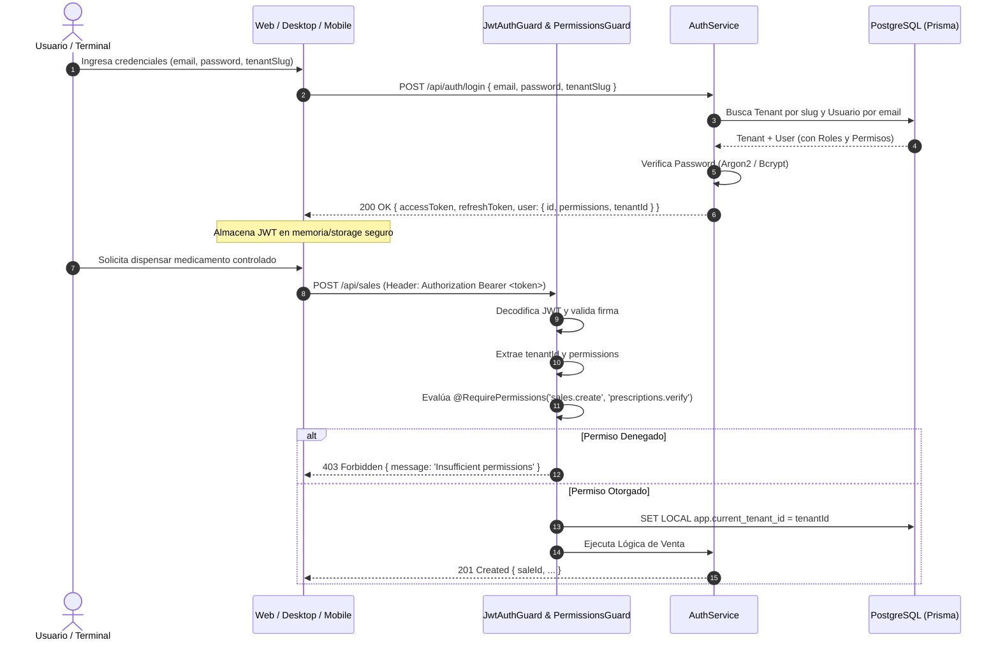
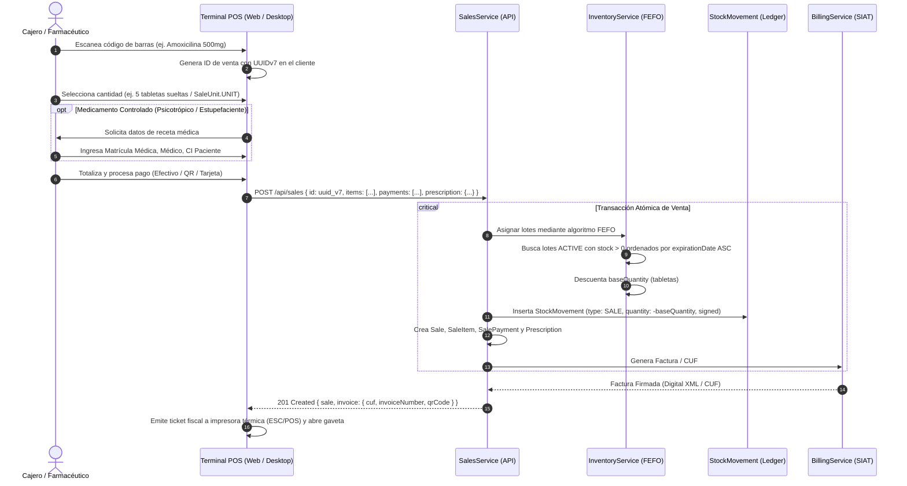
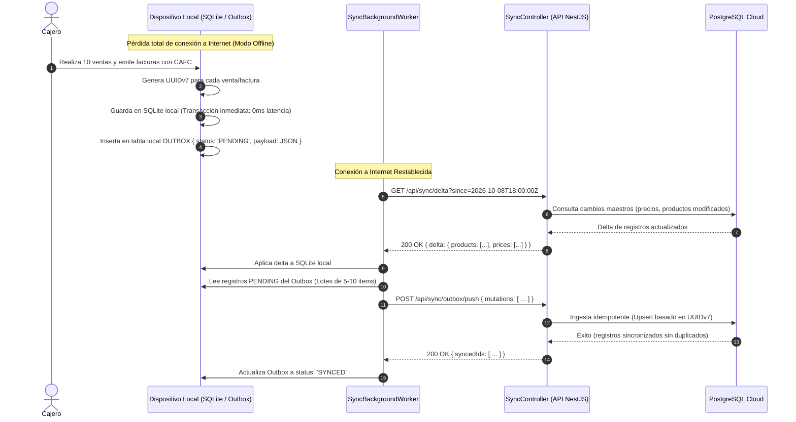
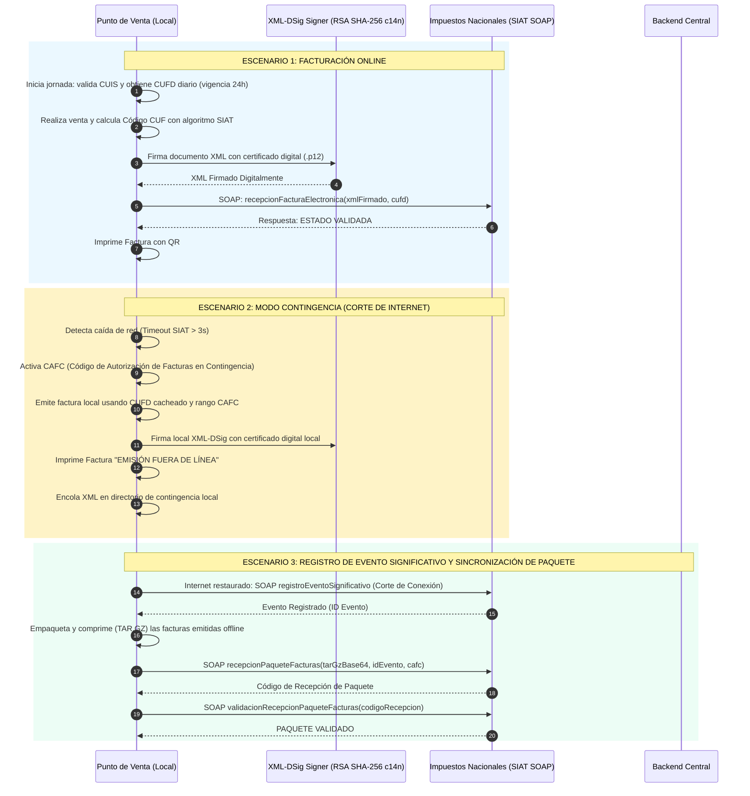
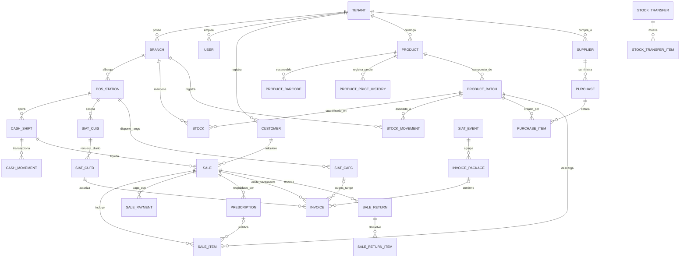

# Pharma ERP — API Architecture & System Diagrams

Este documento describe la arquitectura técnica, diseño modular, flujos de secuencia y modelo entidad-relación del backend de **Pharma ERP** (`apps/api`), construido sobre NestJS 11, Prisma 7, PostgreSQL 17 (con Row-Level Security), autenticación JWT/RBAC, sincronización offline-first con UUIDv7 y facturación electrónica (SIN SIAT v2).

---

## 1. Diagrama de Contexto del Sistema (C4 - Nivel 1 & 2)

El siguiente diagrama ilustra la interacción entre los clientes de la plataforma (Web, Desktop Tauri, Mobile Expo), el API Gateway/Servicio NestJS, la base de datos PostgreSQL y los servicios externos (Impuestos Nacionales SIAT, Pasarelas de Pago Bancarias, Correo Transaccional).

```mermaid
flowchart TB
    subgraph Clients["Clientes Frontend & Dispositivos"]
        WEB["Apps Web (React 19 / Vite)\n- Backoffice Administrativo\n- Reportes Gerenciales\n- POS Web"]
        DESKTOP["Apps Desktop (Tauri 2 + Rust)\n- Terminales de Caja Fija\n- Control Periféricos (ESC/POS, Gaveta, Balanza)\n- Bóveda Local Certificado .p12"]
        MOBILE["Apps Mobile (React Native / Expo)\n- Inventario Móvil en Bodega\n- POS Portátil Offline\n- Escaneo de Barras con Cámara"]
    end

    subgraph BackendGateway["Infraestructura Backend (apps/api)"]
        API["NestJS 11 Application Server\n- REST API (Zod Validation)\n- Multi-Tenant Middleware / Guard\n- RBAC Permission Enforcement\n- Sync & Outbox Delta Processor\n- XML-DSig / Fiscal Engine"]
        CACHE["Memory / Redis Cache\n- Daily CUFD & Token Cache\n- Rate Limiting\n- Active Sessions"]
    end

    subgraph DataTier["Capa de Datos & Persistencia"]
        DB[(PostgreSQL 17 Database\n- Strict Row-Level Security (RLS)\n- UUIDv7 Primary Keys\n- Append-Only Stock Ledger\n- 37 Tablas Relacionales)]
    end

    subgraph ExternalServices["Servicios Externos e Integraciones"]
        SIAT["SIN Bolivia SIAT v2\n- Web Services SOAP\n- Validación CUIS / CUFD\n- Recepción Facturas & Paquetes"]
        BANK["Pasarela Bancaria / QR Simple\n- REST API Firmado\n- Notificaciones Webhook"]
        SMTP["Resend / SMTP\n- Envío de Facturas y Notificaciones"]
    end

    WEB -->|"HTTPS / REST (JWT)"| API
    DESKTOP -->|"HTTPS / REST (JWT) + Sync"| API
    MOBILE -->|"HTTPS / REST (JWT) + Delta Sync"| API

    API -->|"Prisma 7 (Driver Adapter)"| DB
    API <--> CACHE
    API -->|"SOAP / XML-DSig"| SIAT
    API -->|"REST Firmado"| BANK
    API -->|"HTTPS"| SMTP
```

---

## 2. Arquitectura Interna del API (NestJS Modular Clean Architecture)

El backend sigue una arquitectura modular en capas con separación estricta de responsabilidades:

```mermaid
flowchart TD
    subgraph RequestPipeline["Tubería de Solicitud (HTTP Request Pipeline)"]
        REQ[Cliente Request] --> CORS[CORS & Helmet Middleware]
        CORS --> TENANT[TenantIdentificationMiddleware\n(Header / Subdominio)]
        TENANT --> AUTH_G[JwtAuthGuard\n(@Public bypass)]
        AUTH_G --> RBAC_G[PermissionsGuard\n(@RequirePermissions)]
        RBAC_G --> PIPE[ZodValidationPipe\n(Schema Validation DTO)]
    end

    subgraph ModulesLayer["Módulos de Dominio (apps/api/src/modules)"]
        AUTH_M["AuthModule\n- Registro de Tenant\n- Login JWT / Google\n- Refresh Tokens"]
        PROD_M["CatalogModule\n- Productos & Barcodes\n- Precios & Historial\n- Categorías Controladas"]
        STOCK_M["InventoryModule\n- Lotes & Vencimiento (FEFO)\n- Ledger de Movimientos\n- Transferencias & Ajustes"]
        POS_M["SalesModule\n- Venta Mostrador (UUIDv7)\n- Fraccionamiento (Cajas/Unidades)\n- Recetas Médicas"]
        CASH_M["CashModule\n- Apertura / Cierre de Turno\n- Arqueo de Caja\n- Movimientos de Efectivo"]
        BILL_M["BillingModule\n- FiscalAdapter Interface\n- SinAdapter (SIAT Bolivia)\n- Gestor de Contingencia"]
        SYNC_M["SyncModule\n- Delta Sync (since timestamp)\n- Outbox Batch Ingestion\n- Resolución de Conflictos"]
    end

    subgraph IntegrationsLayer["Servicios de Integración (apps/api/src/modules/integrations)"]
        SOAP_S["SoapClientService\n(WSDL SIAT)"]
        SIG_S["SignatureService\n(XML-DSig, RSA-SHA256, c14n)"]
        BANK_S["BankQrService\n(Integración Pago QR)"]
        MAIL_S["MailService\n(Resend Transaccional)"]
    end

    subgraph PersistenceLayer["Persistencia & Acceso a Datos"]
        PRISMA["PrismaService\n(Client PostgreSQL con RLS Context)"]
        PG_RLS[PostgreSQL RLS\nSET LOCAL app.current_tenant_id]
    end

    PIPE --> ModulesLayer
    ModulesLayer --> IntegrationsLayer
    ModulesLayer --> PRISMA
    PRISMA --> PG_RLS
```

---

## 3. Flujo de Autenticación, Resolución de Tenant y Autorización RBAC



---

## 4. Flujo de Venta en Punto de Venta (POS) y Asignación FEFO

La farmacia opera bajo la regla **FEFO** (*First-Expired, First-Out*), priorizando los lotes más próximos a vencer en estado `ACTIVE`. Soporta venta fraccionada (caja entera vs. comprimidos sueltos).



---

## 5. Arquitectura Offline-First y Motor de Sincronización Delta

Las sucursales rurales o de baja conectividad deben continuar operando al 100% sin conexión a internet.



---

## 6. Motor Fiscal SIAT Bolivia: Modo Online vs. Modo Contingencia



---

## 7. Diagrama Entidad-Relación Detallado (ERD de Dominio)



---

## 8. Catálogo Estructurado de Endpoints REST del API

| Método | Endpoint | Permiso Requerido | Descripción |
| :--- | :--- | :--- | :--- |
| **POST** | `/api/auth/register` | `@Public()` | Registro inicial de empresa tenant y usuario owner |
| **POST** | `/api/auth/login` | `@Public()` | Autenticación con email/contraseña y tenant |
| **POST** | `/api/auth/google` | `@Public()` | Autenticación mediante Google OAuth Identity Token |
| **GET** | `/api/auth/me` | Autenticado | Perfil de usuario, permisos activos y sucursales asignadas |
| **GET** | `/api/products` | `catalog.read` | Listado paginado de productos, códigos y precios |
| **POST** | `/api/products` | `catalog.write` | Creación de producto con metadata sanitaria y controlada |
| **GET** | `/api/inventory/batches` | `inventory.read` | Consulta de lotes FEFO con estado y fecha de vencimiento |
| **POST** | `/api/inventory/adjustments` | `inventory.write` | Ajuste manual de stock con motivo y firma de auditoría |
| **POST** | `/api/inventory/transfers` | `inventory.transfer` | Transferencia entre sucursales (`IN_TRANSIT`, `RECEIVED`) |
| **POST** | `/api/purchases` | `purchases.create` | Recepción de orden de compra y registro de nuevos lotes |
| **POST** | `/api/cash/shifts/open` | `cash.open` | Apertura de turno de caja con saldo inicial |
| **POST** | `/api/cash/shifts/close` | `cash.close` | Cierre de turno, arqueo ciego y cálculo de diferencias |
| **POST** | `/api/sales` | `sales.create` | Creación de venta, asignación FEFO y emisión fiscal |
| **POST** | `/api/sales/:id/cancel` | `sales.cancel` | Anulación de venta, reversa de inventario y baja fiscal |
| **POST** | `/api/sales/returns` | `sales.return` | Devolución parcial de productos y nota de crédito fiscal |
| **GET** | `/api/prescriptions` | `prescriptions.read` | Libro oficial de estupefacientes y psicotrópicos |
| **POST** | `/api/fiscal/invoices` | `fiscal.invoice` | Emisión y firma XML-DSig de factura electrónica SIAT |
| **POST** | `/api/fiscal/events` | `fiscal.event` | Declaración de evento significativo (contingencia) |
| **POST** | `/api/fiscal/packages` | `fiscal.package` | Envío de paquete masivo de facturas emitidas offline |
| **GET** | `/api/sync/delta` | `sync.read` | Consulta delta de registros modificados desde cursor de tiempo |
| **POST** | `/api/sync/outbox/push` | `sync.write` | Ingesta masiva e idempotente de mutaciones generadas offline |
