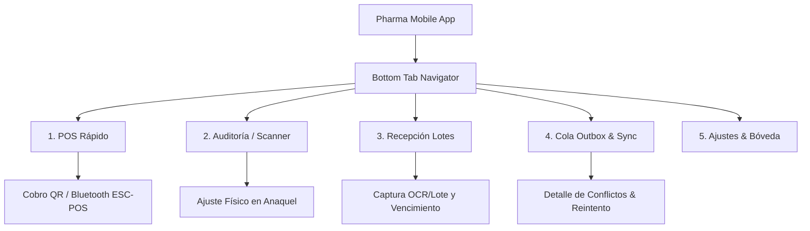

# Pharma ERP — Mobile Application Wireframes & Field UX Specification

Este documento define la arquitectura de interfaz de usuario, flujos de navegación táctil y especificación de pantallas para la aplicación móvil (**apps/mobile**), construida con **React Native (Expo), NativeWind (Tailwind CSS) y componentes shadcn-like (React Native Reusables)**, orientada a operaciones de bodega, conteo físico de inventario, venta portátil de descongestión y sincronización offline en redes 2G/3G.

---

## 1. Arquitectura de Navegación y UX Móvil

La aplicación móvil está diseñada para uso continuo con una sola mano, alto contraste para visores de bodega y respuesta táctil inmediata con **0ms de latencia de interfaz** (local-first SQLite writes).



---

## 2. Pantalla 1: POS Móvil Rápido (Descongestión de Mostrador / Venta Portátil)

Permite a los auxiliares de farmacia recorrer la fila en momentos de alta afluencia, armar el carrito de compras del cliente escaneando con la cámara y transferir el ticket a caja o cobrar con tarjeta/QR y mini-impresora Bluetooth.

### 2.1 Wireframe

```
+-----------------------------------+
|  18:32  [4G]             [85%] [=]|
|  PHARMA ERP MOBILE - POS PORTÁTIL |
|  Sucursal Central | Turno: Andrés |
+-----------------------------------+
| [ SCAN CÁMARA (FOTO) ] [ Buscar ] |
+-----------------------------------+
| CLIENTE: Juan Pérez (4892019)     |
+-----------------------------------+
| ARTÍCULOS EN CARRITO (3 items)    |
|                                   |
| +-------------------------------+ |
| | Paracetamol 500mg (L-202)     | |
| | Vence: 20/10/26 (FEFO Activo) | |
| | [-]  10 Comprimidos  [+]      | |
| |                   Bs 5.00     | |
| +-------------------------------+ |
| | Amoxicilina 500mg (AMX-009)   | |
| | Vence: 27/10/26               | |
| | [-]  1 Caja (10 cáps) [+]     | |
| |                  Bs 35.00     | |
| +-------------------------------+ |
| | Suero Oral Rehidratante       | |
| | [-]  2 Sobres        [+]      | |
| |                   Bs 8.00     | |
| +-------------------------------+ |
|                                   |
| TOTAL A PAGAR:        Bs 48.00    |
+-----------------------------------+
| [  [!] MEDICAMENTO CONTROLADO ]   |
| (Ningún producto de la lista      |
|  requiere receta archivada)       |
+-----------------------------------+
| [     COBRAR / IMPRIMIR (BT)    ] |
| [    TRANSFERIR TICKET A CAJA   ] |
+-----------------------------------+
|  [$] POS   [#] Scan   [+] In   [^]|
|  Venta     Auditoría  Recep   Sync|
+-----------------------------------+
```

---

## 3. Pantalla 2: Auditoría de Inventario & Escáner Continuo de Anaquel

Diseñada para el equipo de almacén que recorre pasillos y estanterías validando existencias reales contra el saldo teórico del sistema.

### 3.1 Wireframe

```
+-----------------------------------+
|  18:33  [OFFLINE]        [84%] [=]|
|  AUDITORÍA DE ESTANTERÍA          |
|  Ubicación: Pasillo B - Anaquel 3 |
+-----------------------------------+
| +-------------------------------+ |
| |   [    VISOR DE CÁMARA    ]   | |
| |       [   ||||||||||||   ]    | |
| |       Apunte al código        | |
| |   [x] Linterna   [v] Lote OCR | |
| +-------------------------------+ |
|                                   |
| PRODUCTO DETECTADO:               |
| Nombre: Ibuprofeno 400mg          |
| Código: 777018291012              |
| Laboratorio: Droguería INTI       |
|                                   |
| LOTES ENCONTRADOS EN SISTEMA:     |
| [o] Lote: IB-910 | Vence: 12/2026 |
|     Teórico: 40 cajas (400 comp)  |
|                                   |
| CONTEO FÍSICO REAL EN ANAQUEL:    |
|                                   |
|   [  - 10  ]   [ 38 cajas ]   [ +10 ] |
|                                   |
| Diferencia encontrada: -2 cajas   |
| Motivo de ajuste:                 |
| [ Merma / Deterioro de blíster v ]|
|                                   |
| [   CONFIRMAR AJUSTE LOCAL (0ms) ]|
+-----------------------------------+
|  [$] POS   [#] Scan   [+] In   [^]|
|  Venta     Auditoría  Recep   Sync|
+-----------------------------------+
```

---

## 4. Pantalla 3: Recepción de Mercadería & Validación de Lote / Caducidad

Recepción directa en muelle de descarga. El operador escanea el empaque del proveedor y registra el número de lote y fecha de vencimiento impresos por el laboratorio.

### 4.1 Wireframe

```
+-----------------------------------+
|  18:34  [4G]             [83%] [=]|
|  RECEPCIÓN DE COMPRA #OC-4019     |
|  Proveedor: Laboratorios Bagó     |
+-----------------------------------+
| Item 3 de 8: Ciprofloxacino 500mg |
| Pedido en OC: 100 cajas           |
+-----------------------------------+
| DATOS DE LABORATORIO:             |
|                                   |
| Código de Barras:                 |
| [ 777019283719                  ] |
|                                   |
| Número de Lote del Fabricante:    |
| [ CPX-2026-99A                  ] |
|                                   |
| Fecha de Vencimiento:             |
| Mes: [ 11 v ]   Año: [ 2028 v ]   |
|                                   |
| Cantidad de Cajas Recibidas:      |
| [ 100 cajas                     ] |
|                                   |
| Unidades por Caja (Base units):   |
| [ 10 comprimidos                ] |
|                                   |
| Inspección Sanitaria:             |
| [x] Empaque sin daños             |
| [x] Registro Sanitario Vigente    |
| [ ] Enviar a Cuarentena           |
+-----------------------------------+
| [    INGRESAR A INVENTARIO      ] |
| [    SALTAR AL SIGUIENTE ITEM   ] |
+-----------------------------------+
|  [$] POS   [#] Scan   [+] In   [^]|
|  Venta     Auditoría  Recep   Sync|
+-----------------------------------+
```

---

## 5. Pantalla 4: Gestor de Outbox Local & Monitor de Sincronización 2G/3G

El núcleo de la arquitectura offline-first. Permite visualizar mutaciones pendientes en el dispositivo SQLite y el estado de transmisión hacia el servidor central.

### 5.1 Wireframe

```
+-----------------------------------+
|  18:35  [RED DÉBIL: 2G]  [82%] [=]|
|  MONITOR DE SINCRONIZACIÓN        |
|  ID Terminal: MOB-LPZ-04          |
+-----------------------------------+
| ESTADO DE LA RED:                 |
| Conectividad: 2G (Alta Latencia)  |
| Última Sincronización exitosa:    |
| Hace 14 minutos (18:21)           |
+-----------------------------------+
| COLA DE OPERACIONES PENDIENTES:   |
|                                   |
| [PENDIENTES EN DISPOSITIVO: 4]    |
|                                   |
| 1. Venta POS #01926f-9a           |
|    Total: Bs 48.00 (3 items)      |
|    Hora: 18:32:10 | Modo: OFFLINE |
|    Estado: [ PENDIENTE EN COLA  ] |
|                                   |
| 2. Ajuste Stock Lote IB-910       |
|    Delta: -2 cajas (Merma)        |
|    Hora: 18:33:45 | Modo: OFFLINE |
|    Estado: [ PENDIENTE EN COLA  ] |
|                                   |
| 3. Recepción Lote CPX-2026        |
|    Ingreso: 100 cajas             |
|    Hora: 18:34:30 | Modo: OFFLINE |
|    Estado: [ EN TRANSMISIÓN...  ] |
+-----------------------------------+
| TAMAÑO DEL PAQUETE: 4.2 KB (GZIP) |
| Límite 2G/3G: Máx 10 items/lote   |
+-----------------------------------+
| [  [>>] FORZAR SINCRONIZACIÓN   ] |
+-----------------------------------+
|  [$] POS   [#] Scan   [+] In   [^]|
|  Venta     Auditoría  Recep   Sync|
+-----------------------------------+
```

---

## 6. Pantalla 5: Despacho a Domicilio & Captura de Firma de Receta

Para entregas a domicilio donde se entregan medicamentos controlados o con prescripción médica obligatoria.

### 6.1 Wireframe

```
+-----------------------------------+
|  18:36  [4G]             [81%] [=]|
|  ENTREGA DE RECETA #RX-90412      |
|  Paciente: Juan Pérez Gómez       |
+-----------------------------------+
| DIRECCIÓN DE ENTREGA:             |
| Av. Arce #2140, Edif. Torre Azul  |
| Teléfono: 701-99212               |
+-----------------------------------+
| PRODUCTOS A ENTREGAR:             |
| [x] Clonazepam 2mg (Lista IV)     |
|     Lote: CL-88 | 1 Caja          |
|                                   |
| [!] REQUIERE VERIFICACIÓN DE CI:  |
| Nro Documento: [ 4892019-LP     ] |
| [x] C.I. verificado físicamente   |
| [x] Receta original retenida      |
+-----------------------------------+
| FIRMA DIGITAL DEL RECEPTOR:       |
| +-------------------------------+ |
| |                               | |
| |          Juan Pérez           | |
| |     _______________________   | |
| |    Firme dentro del recuadro  | |
| +-------------------------------+ |
| [  Limpiar Firma  ]               |
+-----------------------------------+
| [   CONFIRMAR ENTREGA Y CERRAR  ] |
+-----------------------------------+
|  [$] POS   [#] Scan   [+] In   [^]|
|  Venta     Auditoría  Recep   Sync|
+-----------------------------------+
```
