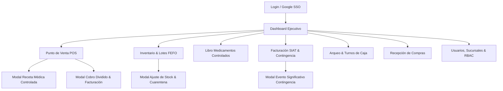

# Pharma ERP — Web Application Wireframes & UI Specification

Este documento define la estructura visual, jerarquía de componentes, flujos de navegación y especificación funcional de la aplicación Web (**apps/web**), desarrollada con **React 19, Vite, Tailwind CSS 4, shadcn/ui, TanStack Query/Table, Zustand y React Hook Form con Zod**.

---

## 1. Sistema de Diseño & Layout Global (App Shell)

El shell de la aplicación proporciona una experiencia uniforme, responsiva y densa en información para farmacéuticos y administradores.

### 1.1 Wireframe: Estructura del Shell Global

```
+---------------------------------------------------------------------------------------------------+
|  [Logo] PHARMA ERP  | [Sucursal Central v] | [Estado SIAT: ONLINE (CUFD 18h) (•)] | [Ctrl+K Buscar] |  (Notif: 3) [Andrés S. (Admin) v] |
+---------------------+-----------------------------------------------------------------------------+
| [NAVBAR LATERAL]    |  BREADCRUMB: Inicio > Punto de Venta                                        |
|                     +-----------------------------------------------------------------------------+
| [*] Dashboard       |                                                                             |
| [$] POS Mostrador   |                                                                             |
| [#] Inventario FEFO |                                                                             |
| [!] Controlados     |                        ÁREA DE CONTENIDO PRINCIPAL                          |
| [=] Compras / Prove |                                                                             |
| [%] Facturación SIN |                                                                             |
| [&] Turnos de Caja  |                                                                             |
| [?] Reportes        |                                                                             |
| [*] Configuración   |                                                                             |
| ------------------- |                                                                             |
| [v] Colapsar Menú   |                                                                             |
| [T] Tenant: Farmasur|                                                                             |
+---------------------+-----------------------------------------------------------------------------+
```

### 1.2 Mapa de Navegación y Flujo de Pantallas Web



---

## 2. Pantalla 1: Dashboard Ejecutivo & Centro de Control

Panel principal para gerentes de farmacia, propietarios y regentes farmacéuticos. Proporciona visibilidad en tiempo real de ventas, lotes por vencer y alertas sanitarias.

### 2.1 Wireframe

```
+---------------------------------------------------------------------------------------------------+
| DASHBOARD GENERAL                   [Hoy: 08 Oct 2026]  [Filtro: Todas las Sucursales v]  [Exportar] |
+---------------------------------------------------------------------------------------------------+
| +---------------------+ +---------------------+ +---------------------+ +---------------------+ |
| | VENTAS HOY (BS)     | | TRANSACCIONES HOY   | | LOTES POR VENCER    | | CAJAS ACTIVAS       | |
| |  Bs 14,850.50       | |  142 tickets        | |  8 lotes (< 30 d)   | |  3 / 3 en línea     | |
| |  [^ +12.4% vs ayer] | |  Ticket prom: 104 Bs| |  [!] 2 en cuarentena| |  Diferencia: 0.00 Bs| |
| +---------------------+ +---------------------+ +---------------------+ +---------------------+ |
+---------------------------------------------------------------------------------------------------+
| [CURVA DE VENTAS HORARIA]                     | [ALERTAS CRÍTICAS DE CADUCIDAD FEFO]              |
|                                               |                                                   |
| Bs 3k |          /\                           | [!] Paracetamol 500mg - Lote L-202 - Vence: 12d   |
| Bs 2k |    /\   /  \    /\                    |     Stock: 45 cajas | Sucursal Central            |
| Bs 1k |   /  \_/    \__/  \                   | [!] Amoxicilina 1g - Lote AMX-9 - Vence: 19d      |
|    0  +------------------------               |     Stock: 12 cajas | Sucursal 2 - Norte          |
|       08:00   12:00   16:00   20:00           | [!] Diazepam 10mg - Lote DZ-44 - Vence: 27d       |
|                                               |     Stock: 3 cajas | REQUIERE RECETA RETENIDA     |
+---------------------------------------------------------------------------------------------------+
| [TOP 5 MEDICAMENTOS MÁS VENDIDOS]             | [ESTADO FISCAL SIAT POR SUCURSAL]                 |
| 1. Ibuprofeno 400mg - 120 unids (Bs 240)      | Sucursal Central : CUFD Válido (Vence 03:00 AM)   |
| 2. Losartán 50mg    - 85 unids (Bs 425)       | Sucursal Norte   : CUFD Válido (Vence 03:00 AM)   |
| 3. Omeprazol 20mg   - 60 unids (Bs 180)       | Sucursal Sur     : MODO CONTINGENCIA (CAFC Activo)|
+---------------------------------------------------------------------------------------------------+
```

---

## 3. Pantalla 2: Punto de Venta (POS) & Mostrador

Optimizada para dispensación rápida, validación automática de lotes más próximos a vencer (FEFO), soporte para venta en fraccionamiento (caja completa o comprimidos sueltos) y captura de recetas controladas.

### 3.1 Wireframe

```
+---------------------------------------------------------------------------------------------------+
| POS MOSTRADOR  |  Turno: #104 (Andrés)  |  Estación: Caja 1  |  [F2: Buscar Prod] [F4: Cobrar]    |
+-------------------------------------------------------------------+-------------------------------+
| BUSCADOR: [ Ingrese nombre comercial, principio activo o escanee ]| CLIENTE FACTURA (NIT/CI)      |
| (Ej: "Amoxi", "847000123456", "Paracetamol")                      | NIT/CI: [ 4892019012 ] [Buscar|
+-------------------------------------------------------------------+ Razón: [ Juan Pérez Gómez    ]|
| PRODUCTOS EN VENTA ACTUAL (UUIDv7: 01926ef4...)                   | Complemento: [  ] Excepción[ ]|
|                                                                   +-------------------------------+
| COD / PRODUCTO          LOTE (FEFO)     UNIDAD   CANT    P.UNIT   | RESUMEN DE COMPRA             |
| ----------------------------------------------------------------- | Subtotal:           Bs 112.00 |
| 77701 Paracetamol 500mg L-202 (12d) [V] Comprim   10    Bs 0.50   | Descuento (0%):       Bs 0.00 |
| 77709 Amoxicilina 500mg AMX-9 (19d) [V] Caja       1    Bs 35.00  | ----------------------------- |
| 77801 Clonazepam 2mg*   CL-88 (95d) [V] Caja       1    Bs 72.00  | TOTAL A COBRAR:     Bs 112.00 |
|   [*] Requiere Receta Médica: [Rx-9021 Dr. Flores Registrada [v]] |                               |
|                                                                   +-------------------------------+
|                                                                   | FORMAS DE PAGO [F4]           |
|                                                                   | [x] Efectivo       Bs 112.00  |
|                                                                   | [ ] Pago QR Simple Bs   0.00  |
|                                                                   | [ ] Tarjeta Débito Bs   0.00  |
|                                                                   |                               |
|                                                                   | Entregado: [ Bs 150.00      ] |
|                                                                   | Cambio:    [ Bs  38.00      ] |
|                                                                   |                               |
|                                                                   | [  [F4] EMITIR FACTURA  ]     |
|                                                                   | [ [Esc] Cancelar Venta ]      |
+-------------------------------------------------------------------+-------------------------------+
```

### 3.2 Modal de Receta Médica para Controlados (Prescription Modal)

```
+-------------------------------------------------------------+
| REGISTRO DE RECETA MÉDICA - MEDICAMENTO CONTROLADO          |
+-------------------------------------------------------------+
| Producto: Clonazepam 2mg (Lista IV - Psicotrópico)          |
|                                                             |
| Número de Receta Archivada:    [ RX-2026-90412            ] |
| Matrícula Profesional Médico:  [ MED-7891-LP              ] |
| Nombre Completo del Médico:    [ Dra. Carmen Valdivia     ] |
| C.I. del Paciente:             [ 4892019-LP               ] |
| Nombre del Paciente:           [ Juan Pérez Gómez         ] |
| Diagnóstico / Indicación:      [ Trastorno de ansiedad    ] |
| Cantidad Prescrita (unids):    [ 30                       ] |
|                                                             |
| [ ] La receta original queda retenida en archivo físico.   |
|                                                             |
| [  Cancelar  ]                  [  Confirmar & Justificar ] |
+-------------------------------------------------------------+
```

---

## 4. Pantalla 3: Gestión de Inventario & Matriz de Lotes (FEFO)

Visualización jerárquica de catálogo, existencias en base units (comprimidos, ml, ampollas), control de caducidades y bloqueo preventivo de lotes.

### 4.1 Wireframe

```
+---------------------------------------------------------------------------------------------------+
| INVENTARIO Y LOTES FEFO  [Filtro: Todos v] [Estado: Todos v] [Buscar producto...] [+ Ajuste Stock] |
+---------------------------------------------------------------------------------------------------+
| [x] Solo próximos a vencer (<60 días)  [ ] En cuarentena  [ ] Agotados                            |
+---------------------------------------------------------------------------------------------------+
| PRODUCTO / PRINCIPIO      CATEGORÍA      LOTE      VENCE       ESTADO     EN STOCK      ACCIONES  |
| ------------------------------------------------------------------------------------------------- |
| Amoxicilina 500mg         Antibiótico    AMX-009   27/10/2026  ACTIVO     42 cajas      [Lotes v] |
|   > Fraccionable: 10 comp/caja | Base: 420 comp | Reg: NN-1243/21          (420 unids)  [Ajustar] |
|                                                                                                   |
| Paracetamol 500mg         Analgésico     L-202     20/10/2026  CRÍTICO    15 cajas      [Lotes v] |
|   > Vencimiento en 12 días | Prioridad de despacho FEFO: ALTA              (150 unids)  [Rematar] |
|                                                                                                   |
| Morfina Clorhidrato 10mg  ESTUPEFACIENTE MF-881    15/05/2027  ACTIVO     25 ampollas   [Lotes v] |
|   > CONTROLADO LISTA II | Libro Folio #42 | Almacén Seguro                 (25 unids)   [Auditar] |
|                                                                                                   |
| Omeprazol 20mg Cápsulas   Gastro         OM-112    01/01/2026  VENCIDO    0 cajas       [Baja]    |
|   > Lote dado de baja automáticamente por el sistema                       (0 unids)              |
|                                                                                                   |
| Ciprofloxacino 500mg      Antibiótico    CP-990    12/12/2027  CUARENTENA 100 cajas     [Liberar] |
|   > Retenido por informe de calidad del laboratorio proveedor              (1,000 unids)|[Rechazar]|
+---------------------------------------------------------------------------------------------------+
| Mostrando 1-5 de 842 productos | Pag: [<] 1 [2] [3] ... [42] [>]                                   |
+---------------------------------------------------------------------------------------------------+
```

---

## 5. Pantalla 4: Libro Oficial de Medicamentos Controlados

Cumplimiento estricto de las normativas de la autoridad sanitaria (AGEMED / Ministerio de Salud). Registro inmutable tipo libro diario encuadernado.

### 5.1 Wireframe

```
+---------------------------------------------------------------------------------------------------+
| LIBRO OFICIAL DE CONTROLADOS (ESTUPEFACIENTES Y PSICOTRÓPICOS)        [Mes: Octubre 2026 v] [PDF] |
+---------------------------------------------------------------------------------------------------+
| Sustancia: [ Clonazepam 2mg (Lista IV Psicotrópico) v ]    Folio Oficial: #084                    |
+---------------------------------------------------------------------------------------------------+
| FECHA/HORA        MOVIMIENTO   Nº RECETA     MÉDICO / MATRÍCULA   PACIENTE / CI   ENTR SALD TOTAL |
| ------------------------------------------------------------------------------------------------- |
| 01/10/2026 09:00  INVENTARIO   -             Saldo Inicial Mes    -                 -    -   150  |
| 03/10/2026 11:20  COMPRA       FAC-8901      Droguería INTI       -                50    -   200  |
| 05/10/2026 15:40  DISPENSACIÓN RX-2026-8812  Dr. M. Solares (441) R. Peña (381921)  -    1   199  |
| 08/10/2026 18:22  DISPENSACIÓN RX-2026-9041  Dra. C. Valdivia(78) J. Pérez (489201) -    1   198  |
+---------------------------------------------------------------------------------------------------+
| TOTAL ENTRADAS: +50 unidades  |  TOTAL SALIDAS: -2 unidades  |  EXISTENCIA ACTUAL: 198 unidades   |
+---------------------------------------------------------------------------------------------------+
| [!] Todas las recetas físicas correspondientes se encuentran foliadas y archivadas en el cajón A-3.|
+---------------------------------------------------------------------------------------------------+
```

---

## 6. Pantalla 5: Facturación Electrónica SIN SIAT & Contingencias

Gestión de la comunicación con el Servicio de Impuestos Nacionales de Bolivia, tokens CUIS/CUFD, eventos y emisión fuera de línea.

### 6.1 Wireframe

```
+---------------------------------------------------------------------------------------------------+
| SIAT FACTURACIÓN ELECTRÓNICA EN LÍNEA                       [Actualizar Estado] [Configurar SIAT] |
+---------------------------------------------------------------------------------------------------+
| SUCURSAL: Sucursal Central (Cod: 0)  |  PUNTO DE VENTA: Mostrador 1 (Cod: 1)                      |
|                                                                                                   |
| ESTADO DE CONEXIÓN: [  EN LÍNEA (ONLINE)  ]  |  TIEMPO RESTANTE CUFD: [ 18 hrs 42 mins ]          |
| CUIS Activo: [ B8A901F4... ] Validez: 24/11/2026 | CUFD Actual: [ F09281... ] Validez: 09/10 03:00|
| CAFC Autorizado (Contingencia): [ CAFC-2026-00918 ] Rango: 1 al 5,000 (Usados: 14)                |
+---------------------------------------------------------------------------------------------------+
| ACCIONES DE CONTINGENCIA:                                                                         |
| [  [!] DECLARAR EVENTO SIGNIFICATIVO (CORTE DE INTERNET / FALLA DE COMUNICACIÓN)  ]               |
+---------------------------------------------------------------------------------------------------+
| FACTURAS EMITIDAS HOY (ÚLTIMAS 5)                                                                 |
|                                                                                                   |
| NRO  FECHA/HORA       CLIENTE / NIT           TOTAL     ESTADO SIAT       CUF / MODALIDAD ACCIONES|
| ------------------------------------------------------------------------------------------------- |
| 142  08/10 18:22:10   Juan Pérez (4892019)    Bs 112.00 VALIDADA (Online) 8F09A... [PDF] [Reenviar|
| 141  08/10 18:14:02   Sonia Vega (3829101)    Bs  45.00 VALIDADA (Online) 7E01B... [PDF] [Reenviar|
| 140  08/10 17:50:33   Sin Nombre (0)          Bs  12.50 VALIDADA (Online) 1A92C... [PDF] [Reenviar|
| 139  08/10 16:30:11   Carlos Soliz (8920192)  Bs 340.00 ANULADA           991FF... [Acta Anulación|
+---------------------------------------------------------------------------------------------------+
| PAQUETES MASIVOS PENDIENTES DE ENVÍO: 0 paquetes en cola (Todos validados con SIAT)               |
+---------------------------------------------------------------------------------------------------+
```

---

## 7. Pantalla 6: Administración de Sucursales & Matriz de Roles (RBAC)

Configuración multi-tenant para administrar roles con control estricto de accesos (`@RequirePermissions`).

### 7.1 Wireframe

```
+---------------------------------------------------------------------------------------------------+
| CONTROL DE ACCESO & ROLES (RBAC)                                       [+ Nuevo Rol]  [Guardar]   |
+---------------------------------------------------------------------------------------------------+
| ROL SELECCIONADO: [  FARMACÉUTICO REGENTE v  ]                                                    |
| Descripción: Responsable técnico del despacho de medicamentos, controlados y recetas.             |
+---------------------------------------------------------------------------------------------------+
| MÓDULO               PERMISO DE SISTEMA             DESCRIPCIÓN                        ESTADO     |
| ------------------------------------------------------------------------------------------------- |
| Catálogo             catalog.read                   Ver catálogo de medicamentos       [x] ACTIVO |
| Catálogo             catalog.write                  Editar productos y precios         [ ] INACT  |
| Ventas (POS)         sales.create                   Emitir ventas y cobrar tickets     [x] ACTIVO |
| Ventas (POS)         sales.cancel                   Anular ventas confirmadas          [ ] INACT  |
| Controlados          prescriptions.read             Ver libro de estupefacientes       [x] ACTIVO |
| Controlados          prescriptions.verify           Validar y retener recetas médicas  [x] ACTIVO |
| Inventario           inventory.read                 Consultar stock y lotes            [x] ACTIVO |
| Inventario           inventory.write                Realizar ajustes de inventario     [ ] INACT  |
| Inventario           inventory.transfer             Transferir entre sucursales        [x] ACTIVO |
| Facturación SIAT     fiscal.invoice                 Emitir facturas electrónicas       [x] ACTIVO |
| Facturación SIAT     fiscal.event                   Declarar eventos de contingencia   [x] ACTIVO |
| Caja                 cash.open                      Aperturar turno de caja            [x] ACTIVO |
| Caja                 cash.close                     Cerrar y arquear turno de caja     [x] ACTIVO |
+---------------------------------------------------------------------------------------------------+
```
